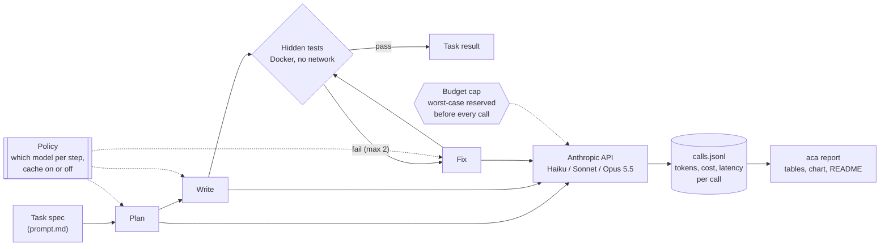

<h1 align="center">agent-cost-audit</h1>

<p align="center"><strong>How much do model routing and prompt caching really cut the cost of an AI coding agent, and does quality hold? Measured on 829 real API calls.</strong></p>

<p align="center">
  <a href="https://github.com/prattaybanik03/agent-cost-audit/actions/workflows/ci.yml"></a>
  
  
  
  
  
  <a href="LICENSE"></a>
</p>

## At a glance

| | |
| --- | --- |
| **The question** | On the same coding-agent workload, how much do model routing and prompt caching cut API cost, and does quality hold? |
| **The answer** | The cheapest model was enough. Haiku 5.5 alone did the work for **96% less** than Opus 5.5 and passed every task. Routing (Opus plans, Haiku writes) saved 51%. Caching the system prompt saved a further 11% to 12%. |
| **The catch** | Caching cannot touch output tokens, which were 73% to 91% of spend. Routing spent 95% of its budget on an Opus planning step that bought nothing measurable. The cheap route failed, and cost more than Opus, when its output limit was sized for the expensive model. |
| **The evidence** | 10 tasks × 8 policies × 5 repetitions: 400 task runs, 829 real API calls, US$26.62. Hidden tests ran in a Docker sandbox with no network, and every figure here is generated from the logged run. 214 tests run in CI. |
| **My role** | I set the question and the business case and made the product and architecture decisions. I directed AI coding agents through each stage, verified the numbers and shipped it. See [How this was built](#how-this-was-built). |


## The finding

<!-- results:start -->

| Policy | Cost per run of all 10 tasks | vs Opus | Passed | First try (95% interval) |
| --- | ---: | ---: | ---: | ---: |
| `opus` | $1.45 | baseline | 50/50 | 94% (84% to 98%) |
| `opus_cached` | $1.28 | -12% | 50/50 | 94% (84% to 98%) |
| `routed` | $0.72 | -51% | 50/50 | 90% (79% to 96%) |
| `routed_cached` | $0.64 | -56% | 50/50 | 92% (81% to 97%) |
| `sonnet` | $0.60 | -59% | 50/50 | 94% (84% to 98%) |
| `sonnet_cached` | $0.53 | -64% | 50/50 | 96% (87% to 99%) |
| `haiku` | $0.0557 | -96% | 50/50 | 90% (79% to 96%) |
| `haiku_cached` | $0.0491 | -97% | 50/50 | 94% (84% to 98%) |

**What caching added on its own** (same models, same steps, only `cache_control` differs), and how much of each policy's spend was output tokens, which caching cannot reduce:

| Models | Saving from caching | Range over repetitions | Cache writes | Output share of spend |
| --- | ---: | ---: | ---: | ---: |
| `opus` | -12% | -24% to -1% | 2 | 77% |
| `sonnet` | -11% | -17% to +3% | 1 | 73% |
| `haiku` | -12% | -17% to -7% | 1 | 85% |
| `routed` | -11% | -13% to -9% | 2 | 83% |

<!-- results:end -->

What it means:

- **Start with the cheapest model and prove you need more.** On ten precisely specified tasks, Haiku's first-try pass rate (90%) sat inside Opus's 95% interval (84% to 98%). The run shows no quality difference for a 26-fold difference in cost.
- **Routing is only as good as what it routes.** The routed policy kept Opus for planning on every task. That step was 95% of its spend, and Haiku never needed the Opus fix it was holding in reserve. It cost about 13 times as much as Haiku alone for the same pass rate.
- **Caching is a real but bounded saving.** A cache read costs 5% to 10% of the input price, but here only the input side could shrink. Each cached policy paid the cache-write premium once or twice in about 100 calls, so the saving held from a cold start.
- **A limit set for the expensive model can break the cheap one.** In a smoke test with a 16,000-token output limit, Haiku's replies on the hardest task were cut off mid-answer. The cached routed policy then spent **12% more** than cached Opus, and still failed. Raising the limit to 64,000 fixed it. That case is published separately in [`results/smoke-16k-limit/`](results/smoke-16k-limit/report.md), with n = 1, so read it as a case, not a rate.

Full tables (latency, cost by step, pass rate by task, rep-by-rep ranges): [`results/report.md`](results/report.md). Per-task data: [`results/summary.csv`](results/summary.csv).

## How it works



Every policy runs the same loop, the same tasks and the same ~1,850-token system prompt at the same effort setting. Only the model per step, and whether the system prompt is cached, change.

| Policy | Plan | Write | Fix 1 | Fix 2 |
| --- | --- | --- | --- | --- |
| `opus` (baseline) | Opus | Opus | Opus | Opus |
| `sonnet` | Sonnet | Sonnet | Sonnet | Sonnet |
| `haiku` | Haiku | Haiku | Haiku | Haiku |
| `routed` | Opus | Haiku | Haiku | Opus |
| `*_cached` | same as its pair, with `cache_control` on the system prompt | | | |

Cost is computed per call from the API's own token counts, priced from the published price list (source and date in [`config/prices.yaml`](config/prices.yaml)). The workload, the sandbox, the budget cap and the logging are in [`docs/method.md`](docs/method.md). The reasons behind each choice, and what each one gives up, are in [`docs/decisions.md`](docs/decisions.md).

## Quick start

Needs Python 3.11+, [uv](https://docs.astral.sh/uv/) and Docker for the network-isolated sandbox.

```bash
uv sync
uv run aca sandbox-build      # build the test sandbox image
uv run pytest                 # 214 tests, mock provider only: no API key, no network calls
```

Run the whole pipeline with the mock provider. There is no spend, and the token counts are estimates, so it proves the pipeline, not the numbers:

```bash
uv run aca run --provider mock --reps 1
uv run aca report results/raw/<run_id> --out results/raw/mock-report
```

A real run. Copy `.env.example` to `.env` and add an Anthropic API key first:

```bash
uv run aca run                                   # 10 tasks × 8 policies × 5 reps, capped in config/run.yaml
uv run aca report results/raw/<run_id> --readme README.md
uv run aca run --tasks e1_interval_merge --policies opus,haiku --reps 1 --cap 1   # a small slice
```

## Repository layout

```
src/aca/        providers (Anthropic, mock), policies, agent loop, sandbox, pricing, budget, call log, report, CLI
tasks/          10 tasks: prompt.md (what the model sees), test_task.py (hidden), reference.py (never in a prompt)
config/         prices.yaml (source and date checked), run.yaml (policies, cap, effort, repetitions)
results/        report.md, summary.csv, chart.png from the published run; smoke-16k-limit/ for the 16,000-limit case
docs/           method.md, decisions.md
tests/          214 tests: pricing, budget, loop, sandbox isolation, report, task strength
sandbox/        Dockerfile for the test sandbox, base image pinned by digest
```

## Limits

- **The tasks were too easy to separate the models on pass rate.** Every policy passed every task. First-try rates differ a little, inside the intervals. Harder tasks are the next step.
- **Small n.** 50 task runs per policy. The tables report the spread, and differences smaller than it are not shown by this run.
- **Prices as of 19 November 2026.** Re-check [`config/prices.yaml`](config/prices.yaml) before relying on any dollar figure.
- **Synthetic, self-contained tasks.** Real agents read files and carry long histories, which makes the cached prefix larger and caching worth more than here.
- **One loop, one provider, one effort setting.** A different harness, provider or effort level would give different numbers.
- **One discarded run.** The first full run's cached policies started on a warm cache. It was discarded and rerun from cold. The details and cost are in [`docs/decisions.md`](docs/decisions.md#d6-cache-entries-isolated-by-policy-and-by-run).
- **Public reference solutions.** They never enter a prompt, but a future model trained on public code could have seen them.

## What I'd do next

- **A budget-aware router** that predicts from the task and the first test result when the strong model is needed, instead of paying for it up front.
- **`aca ingest`** for real agent call logs in the same schema, starting with a multi-agent system from a university team project. It would go through a logging wrapper added there with the team's agreement, and only aggregated numbers would come into this repo.
- **Effort as a policy dimension,** and a small open model on rented GPUs as the cheap step.

## How this was built

I built this as the engineer in charge, directing AI coding agents the way a lead directs a team.

- **I framed the problem and the business case.** I chose the question an AI spend-control product has to answer for a buyer, what result would be credible, and what the benchmark must not claim.
- **I made the product and architecture decisions.** I chose the policy matrix, comparing all three model tiers with routing and caching twins, and set Opus as the baseline. I chose Anthropic models only for v1, the one provider interface, the hard budget cap with worst-case reservation, the Docker sandbox, the call-log schema and the rule that every published number comes from a logged run.
- **I directed the work in stages.** I gave the agents a specification and acceptance criteria for each stage, reviewed what came back, and approved each stage before the next began.
- **I verified it.** I ran the checks below, read the call logs behind the headline numbers, and had an independent agent, which had not seen the work, review the repository against my engineering standards before release.
- **I changed the design when the evidence said so.** I raised the output limit after the smoke test, and turned off refusal fallback so no call could be served by a model other than the one under test. When the independent review found the first full run had started on a warm cache, I fixed the cache isolation and reran the benchmark from cold, rather than publish a caveated result.
- **I shipped it.** I set the release gate, chose the licence and approved the release. The first CI run then exposed a Linux-only sandbox bug, which I reproduced in a container and fixed.

The checks that back the numbers are all in [`tests/`](tests) and need no API key. CI runs them on every push:

- a reference solution that must pass and an empty solution that must fail, for every task;
- 16 planted bugs the hidden tests must catch;
- a brute-force cross-check of all 51 expected dates in the cron task;
- sandbox tests showing no network, no file writes, no visible API key, and no pass for code that exits early or skips tests;
- the budget cap, pricing and cache accounting.

CI also runs lint and type checks. CI actions are pinned to commit SHAs and the sandbox image to a digest. A dependency audit of the 45 locked packages found no known vulnerabilities on 19 November 2026.
