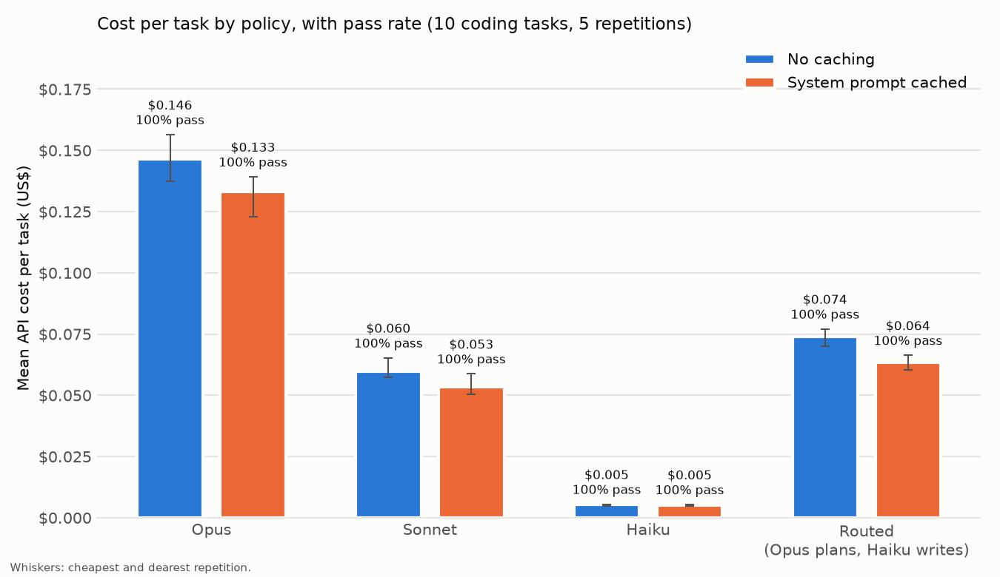

# agent-cost-audit

A small, reproducible benchmark of AI spend control on a multi-agent coding workload: how much do model routing and prompt caching save, and does quality hold?

<!-- headline:start -->
**Result, 400 task runs, US$27.02 in API spend:** on this workload every policy passed every task. Running everything on Haiku 5.5 cut cost by 96% against Opus 5.5. Routing (Opus plans, Haiku writes) cut it by 50%, and caching the system prompt saved a further 5% to 14% depending on the models. The cheap route lost only when its output allowance was too small: at 16,000 tokens, Haiku was cut off mid-answer and failed the hardest task.
<!-- headline:end -->



## The question

Coding agents make many model calls per task: plan, write, test, fix. Two common ways to cut their bill are:

- **Routing.** Send the expensive steps to a strong model and the routine ones to a cheap model.
- **Prompt caching.** Mark the long shared prefix (the system prompt) so repeat calls read it from cache at a fraction of the input price.

Both are sold as savings. This repo measures them on one workload, with real API calls, and counts the cases where the cheaper route ends up costing more or failing.

It is a benchmark and a report, not a product.

## Quick start

Needs Python 3.11+, [uv](https://docs.astral.sh/uv/) and, for the network-isolated sandbox, Docker.

```
uv sync
uv run aca sandbox-build          # builds the test sandbox image (optional; falls back to a subprocess)
uv run pytest                     # unit tests; mock provider only, no API key
```

Reproduce the whole pipeline with the mock provider. No API key, no spend. Token counts are estimates, so the numbers mean nothing; it shows the run, the logs and the report work end to end:

```
uv run aca run --provider mock --reps 1
uv run aca report results/raw/<run_id> --out results/mock
```

A real run. Copy `.env.example` to `.env` and add an Anthropic API key first:

```
uv run aca run                    # 10 tasks x 8 policies x 5 repetitions, hard cap in config/run.yaml
uv run aca report results/raw/<run_id> --readme README.md
```

`aca run --tasks e1_interval_merge --policies opus,haiku --reps 1 --cap 1` runs a slice.

## Method

### Workload

Ten self-contained Python tasks in `tasks/`: 3 easy, 4 medium and 3 hard.

| Tier | Tasks |
| --- | --- |
| Easy | interval merging, LRU cache, Roman numerals with strict validation |
| Medium | token-bucket rate limiter, CSV validator with typed errors, tokenizer for a small expression language, semantic versions and ranges |
| Hard | expression parser and evaluator, next run time for a cron expression, spreadsheet with formulas and cycle detection |

Each task has a written specification (`prompt.md`), a hidden pytest file and a reference solution. The tests were written first. `aca tasks-verify` checks that every reference solution passes and an empty solution fails. A task passes only if every hidden test passes. The model never sees the tests or the reference solution.

### The agent loop

The same loop for every policy:

1. **Plan.** Read the specification and write a short plan.
2. **Write.** Write the module from the specification and the plan.
3. **Test.** Run the hidden tests in the sandbox.
4. **Fix.** On failure, send the code and the test output back. At most 2 fix attempts.

Every call uses the same shared system prompt of about 1,840 tokens (role, coding conventions, a description of the pipeline's tools). It clears the provider's 512-token minimum for caching. Each call is stateless: the loop passes forward only text, so any step can go to a different model.

Every call uses effort `medium` and an output allowance of 64,000 tokens, thinking included. Calls are streamed.

### Policies

| Policy | Plan | Write | Fix 1 | Fix 2 | System prompt cached |
| --- | --- | --- | --- | --- | --- |
| `opus` (baseline) | Opus 5.5 | Opus 5.5 | Opus 5.5 | Opus 5.5 | no |
| `sonnet` | Sonnet 5.5 | Sonnet 5.5 | Sonnet 5.5 | Sonnet 5.5 | no |
| `haiku` | Haiku 5.5 | Haiku 5.5 | Haiku 5.5 | Haiku 5.5 | no |
| `routed` | Opus 5.5 | Haiku 5.5 | Haiku 5.5 | Opus 5.5 | no |
| `*_cached` | as above | | | | yes |

Each `_cached` policy differs from its pair only by `cache_control` on the system prompt. That separates the effect of caching from the effect of routing. The system prompt starts with a one-line policy label, so two policies that use the same model never share a cache entry.

Model IDs: `claude-opus-5-5`, `claude-sonnet-5-5`, `claude-haiku-5-5`.

### Cost

Cost is computed per call from the token counts in the API's usage fields, never estimated. Cache writes and cache reads are priced at their own published rates.

US$ per million tokens, from <https://platform.claude.com/docs/en/about-claude/pricing>, checked 19 November 2026:

| Model | Input | Cache write (5 min) | Cache read | Output |
| --- | ---: | ---: | ---: | ---: |
| Claude Opus 5.5 | 4.00 | 5.00 | 0.20 | 20.00 |
| Claude Sonnet 5.5 | 2.00 | 2.50 | 0.10 | 10.00 |
| Claude Haiku 5.5 | 0.10 | 0.125 | 0.01 | 0.50 |

The table lives in `config/prices.yaml`. A model or prompt size the table does not cover is an error, not a guess.

A hard budget cap is set in `config/run.yaml`. Before every call the runner reserves that call's worst-case cost (the full output allowance, the prompt at the dearest rate). If the reservation could pass the cap, the call is not made and the run stops cleanly.

### Sandbox

Generated code is untrusted. Each test run happens in a fresh Docker container with no network (`--network none`), a read-only file system, no Linux capabilities, a non-root user, and limits on memory, CPU, processes and time. Tests in `tests/test_sandbox.py` check that a socket connection fails, file writes fail and API keys are not visible inside. Without Docker, a subprocess fallback runs with a timeout and a stripped environment; it does not block network access and says so.

### What is logged

`results/raw/<run_id>/calls.jsonl` holds one line per model call: run, task, policy, repetition, attempt, step, provider, the model that served the call, input, output, cache-write and cache-read tokens, latency, cost, stop reason and timestamp. It holds no prompt or response text. Generated code and test output go to `artifacts/` in the same folder. `results/raw/` is not committed.

## Results

<!-- results:start -->

### Headline: cost and quality by policy

Workload cost is the mean cost of each task, summed over all 10 tasks. The range is the cheapest and dearest full repetition. Change is against `opus`. Pass rate is over every task run. First-try rate is the share of task runs that passed with no fix attempt.

| Policy | Workload cost | Range over reps | Cost vs baseline | Pass rate | First-try rate | Fix attempts | Cost per passed task |
| --- | ---: | ---: | ---: | ---: | ---: | ---: | ---: |
| `opus` | $1.46 | $1.37 – $1.56 | baseline | 100% | 94% | 3 | $0.15 |
| `opus_cached` | $1.33 | $1.23 – $1.39 | -9% | 100% | 92% | 4 | $0.13 |
| `routed` | $0.74 | $0.70 – $0.77 | -50% | 100% | 94% | 3 | $0.0739 |
| `routed_cached` | $0.64 | $0.60 – $0.66 | -57% | 100% | 94% | 3 | $0.0635 |
| `sonnet` | $0.60 | $0.57 – $0.65 | -59% | 100% | 94% | 3 | $0.0598 |
| `sonnet_cached` | $0.53 | $0.51 – $0.59 | -64% | 100% | 92% | 4 | $0.0534 |
| `haiku` | $0.0529 | $0.0485 – $0.0552 | -96% | 100% | 94% | 3 | $0.0053 |
| `haiku_cached` | $0.0504 | $0.0478 – $0.0538 | -97% | 100% | 84% | 8 | $0.0050 |


### Caching on its own

Each pair runs the same models on the same steps. The only difference is `cache_control` on the shared system prompt. Cache-read share is the fraction of prompt tokens served from the cache.

| Models | Uncached | Cached | Change | Cache-read share | Pass rate |
| --- | ---: | ---: | ---: | ---: | ---: |
| `opus` | $1.46 | $1.33 | -9% | 48% | 100% → 100% |
| `sonnet` | $0.60 | $0.53 | -11% | 49% | 100% → 100% |
| `haiku` | $0.0529 | $0.0504 | -5% | 50% | 100% → 100% |
| `routed` | $0.74 | $0.64 | -14% | 48% | 100% → 100% |


### Where the money goes

Share of each policy's spend by step, and the share that paid for output tokens (thinking included). Prompt caching can only reduce the rest.

| Policy | Plan | Write | Fix | Output tokens |
| --- | ---: | ---: | ---: | ---: |
| `opus` | 47% | 48% | 5% | 77% |
| `opus_cached` | 47% | 46% | 8% | 85% |
| `sonnet` | 40% | 56% | 4% | 73% |
| `sonnet_cached` | 38% | 57% | 5% | 83% |
| `haiku` | 33% | 63% | 4% | 85% |
| `haiku_cached` | 30% | 63% | 7% | 90% |
| `routed` | 95% | 5% | 0% | 83% |
| `routed_cached` | 95% | 5% | 0% | 92% |


### Where the cheaper route lost

Every task where a policy cost more than `opus` on average, or passed less often. The reasons are read from the call logs.

| Task | Policy | Lost on | Cost | Pass rate | Why |
| --- | --- | --- | ---: | ---: | --- |
| `h3_spreadsheet` | `opus_cached` | cost | $0.4249 vs $0.4243 (+0.1%) | 100% vs 100% | 0.8 fix attempts per run vs 0.6 |


### Latency

Call latency is the time from sending a request to receiving the full streamed reply. Task time includes every call and every test run for that task.

| Policy | Call p50 | Call p95 | Mean task time | Escalations | Output-limit stops |
| --- | ---: | ---: | ---: | ---: | ---: |
| `opus` | 20.4 s | 62.8 s | 52 s | 0 | 0 |
| `opus_cached` | 20.4 s | 63.2 s | 51 s | 0 | 0 |
| `sonnet` | 11.5 s | 37.0 s | 31 s | 0 | 0 |
| `sonnet_cached` | 11.4 s | 31.8 s | 31 s | 0 | 0 |
| `haiku` | 12.0 s | 50.8 s | 39 s | 0 | 0 |
| `haiku_cached` | 11.6 s | 52.0 s | 40 s | 0 | 0 |
| `routed` | 19.2 s | 72.6 s | 54 s | 0 | 0 |
| `routed_cached` | 15.8 s | 63.2 s | 50 s | 0 | 0 |


### Pass rate by task

| Task | `opus` | `opus_cached` | `sonnet` | `sonnet_cached` | `haiku` | `haiku_cached` | `routed` | `routed_cached` |
| --- | ---: | ---: | ---: | ---: | ---: | ---: | ---: | ---: |
| `e1_interval_merge` (easy) | 100% | 100% | 100% | 100% | 100% | 100% | 100% | 100% |
| `e2_lru_cache` (easy) | 100% | 100% | 100% | 100% | 100% | 100% | 100% | 100% |
| `e3_roman_numerals` (easy) | 100% | 100% | 100% | 100% | 100% | 100% | 100% | 100% |
| `m1_rate_limiter` (medium) | 100% | 100% | 100% | 100% | 100% | 100% | 100% | 100% |
| `m2_csv_validator` (medium) | 100% | 100% | 100% | 100% | 100% | 100% | 100% | 100% |
| `m3_tokenizer` (medium) | 100% | 100% | 100% | 100% | 100% | 100% | 100% | 100% |
| `m4_semver` (medium) | 100% | 100% | 100% | 100% | 100% | 100% | 100% | 100% |
| `h1_expr_eval` (hard) | 100% | 100% | 100% | 100% | 100% | 100% | 100% | 100% |
| `h2_cron_next` (hard) | 100% | 100% | 100% | 100% | 100% | 100% | 100% | 100% |
| `h3_spreadsheet` (hard) | 100% | 100% | 100% | 100% | 100% | 100% | 100% | 100% |

<!-- results:end -->

The full per-task table is in [`results/summary.csv`](results/summary.csv) and the report in [`results/report.md`](results/report.md).

### What the numbers say

- **The cheapest model was enough here.** Haiku 5.5 passed all 50 of its task runs, 94% of them on the first try, the same first-try rate as Opus 5.5. These ten tasks do not need a frontier model when the specification is precise.
- **Routing paid for a step that bought nothing.** In `routed`, 95% of the spend went on the Opus planning step. Haiku's code passed before the second fix in every run, so the policy never escalated. It cost about fourteen times as much as Haiku alone for the same pass rate.
- **Caching saved less than its headline rate suggests.** A cache read costs 5% of the input price on Opus and Sonnet and 10% on Haiku. But output tokens, thinking included, were 77% to 92% of every policy's spend, and caching does not touch them. Caching the roughly 1,840-token system prompt cut total cost by 5% to 14%.
- **Caching never raised a policy's total cost here.** Calls arrived seconds apart, well inside the 5-minute cache lifetime, so writes were read back. A workload with longer gaps between calls would pay the write premium without the reads.
- **Haiku was not the fastest.** Its median call was about as fast as Sonnet's, but its slowest calls were slower (p95 51 s against 37 s), because it thought longer on the hard tasks.
- **One number to watch, not trust:** `haiku_cached` passed first time in 84% of runs against 94% for `haiku`, needing 8 fix attempts against 3. Caching does not change what a model sees, so this is most likely noise at n = 5 per task.

### When the cheap route did lose

In the full run, the only row in "Where the cheaper route lost" above is a 0.1% cost difference on one task, which is noise.

The cheap route did lose in the [smoke test](results/smoke-16k-limit/report.md), run with an output allowance of 16,000 tokens (2 tasks × 8 policies × 1 repetition, US$2.24). On the spreadsheet task, every Haiku write and fix hit the limit, so its code was cut off mid-reply. `haiku` and `haiku_cached` failed it outright. `routed` and `routed_cached` escalated to Opus on the last fix and still failed 2 of 115 tests, after spending 88% and 71% of what Opus alone spent to pass. Opus and Sonnet never came near the limit; their largest reply used 11,732 tokens.

Raising the allowance to 64,000 tokens fixed it. The lesson for anyone routing to a cheap model: a per-call output cap set for the expensive model can quietly make the cheap one fail, and the failure looks like poor quality, not a configuration problem.

## Limitations

- **The tasks are too easy to separate the models on pass rate.** Every policy passed every task, so pass rate shows no difference. First-try rate and fix attempts show a little. A harder task set would test whether quality really holds.
- **Small n.** Each task × policy ran 5 times. Differences of a few percent are inside the noise. The ranges in the tables show the spread.
- **Prices as of one date.** Prices were checked on 19 November 2026 and will change. Re-check `config/prices.yaml` before relying on any dollar figure.
- **Synthetic tasks.** Ten self-contained tasks are not a real codebase. Real agents read files, call tools and carry long histories, which makes the cached prefix larger and caching worth more than here.
- **One loop shape.** Results depend on the loop: two fix attempts, stateless calls and one escalation rule. A different harness would give different numbers.
- **One provider, one effort setting.** All models ran at effort `medium`. Effort is itself a cost lever this benchmark does not vary.
- **Public reference solutions.** The reference solutions are in this repo. They never enter a prompt, but a future model trained on public code could have seen them.
- **Hardware not costed.** Only API spend is counted, not the machine that ran the sandbox.

## What I'd do next

- **A budget-aware router.** The routed policy escalates only after a failed cheap fix. A router that predicts from the task and the first test output when escalation is likely could skip the wasted cheap attempts.
- **Run it on real agent logs.** An `aca ingest` command that reads call logs in the same schema and produces the same report. The first target is a multi-agent system from a university team project, through a small logging wrapper added there with the team's agreement. Only aggregated numbers would come into this repo.
- **A small open model in the routing ladder,** served on rented GPUs, to see whether self-hosting the cheap step changes the picture.

## How this was built

I set the question, the architecture and the rules: what to measure, the policies, the budget cap, the sandbox requirements and what counts as evidence. I approved every change. AI coding agents wrote most of the code, the tasks and the tests under those decisions, and ran the checks. I reviewed the results at each stage and made the calls that changed the design, including raising the output allowance after a smoke test showed the cheap model being cut off mid-answer, and turning off refusal fallback so no call could be served by a model other than the one under test.

The checks that back the numbers, all in `tests/` and run in CI with no API key: a reference solution that must pass and an empty solution that must fail for every task, 16 planted bugs the hidden tests must catch (`tests/test_task_strength.py`), a brute-force cross-check of all 51 expected dates in the cron task, and the sandbox isolation tests. 199 tests in all.
